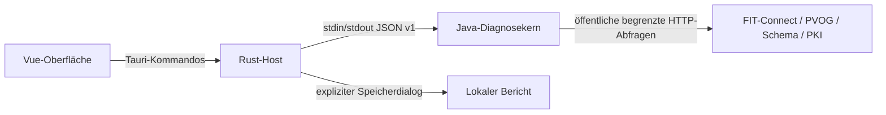

# Architektur und öffentliche Verträge

FBForge Inspect 0.2.0 verwendet denselben lokalen Java-Diagnosekern für eine Windows-Desktop-App und ein portables Windows-/Linux-CLI.



Die Vue-Oberfläche besitzt keinen direkten Netzwerkzugriff auf externe APIs. Der Rust-Host stellt `diagnose`, `cancel`, `save_report`, `open_reference`, `export_cli` und die nativen Updatebefehle bereit. `open_reference` öffnet ausschließlich fest hinterlegte öffentliche Ziele im Systembrowser und akzeptiert keine beliebigen URLs. Für Diagnosen startet der Host pro Prüflauf einen gebündelten Java-Prozess, begrenzt Ein- und Ausgabe und beendet ihn bei Abbruch oder Zeitüberschreitung. Es gibt keinen lokalen HTTP-Server und kein Shell-Plugin. Der Entwicklungsmodus kann den lokal installierten Java-Befehl verwenden, eine Release-App benötigt ihre gebündelte Laufzeit.

Die Netzwerk-Basisprüfung verwendet ausschließlich die für die öffentlichen Inspect-Funktionen benötigten FIT-Connect- und Routing-Ziele der [offiziellen Umgebungsübersicht](https://docs.fitko.de/fit-connect/docs/getting-started/environments/). PVOG und XRepository sind keine Basisproben. Konkrete OCSP-/CRL-Proben entstehen zusätzlich aus ausdrücklich ausgewählten Zertifikaten. Sie bestätigen Erreichbarkeit, keine erfolgreiche Sperrstatusvalidierung.

Der Java-Kern implementiert die öffentlichen API-Verträge eigenständig. Er enthält keinen FIT-Connect-SDK-Adapter. `Api` übernimmt Destination, Routing und Prozesssuche, `Pvog` erhält die Zuständigkeitsseiten und ergänzt Leistungs- und Onlinedienstquellen mit expliziten Kontextpfaden. `KeyDiagnostics` übernimmt die JWK-Regeln, `Certificates` PKIX und Sperrstatus, `Signatures` Adressierungssignaturen, `Schemas` sichere Strukturinspektion und `PublicHttp` die gemeinsame Transportgrenze. Die vollständige Feldzuordnung steht in [PVOG-MAPPING.md](PVOG-MAPPING.md).

## IPC v1

Eine Anfrage pro Prozess, JSON in UTF-8 über stdin bis EOF:

```json
{"protocolVersion":1,"operation":"destination","environment":"TEST","apiVersion":"v3","input":{"destinationId":"00000000-0000-4000-8000-000000000001"}}
```

Operationen: `destination`, `routing`, `areas`, `process`, `limits`, `keys`, `schema`, `network`, `reverse`, `certificate`, `signature`, `rollover`. Die Antwort enthält `ok` und bei Erfolg `report`, sonst eine bereinigte Fehlermeldung ohne Eingabewerte oder Stacktrace. Der Diagnosebericht enthält Version, Operation, Umgebung, Zeit, Befunde, normalisierte Daten, Abfrageprotokoll und separat gehaltene Rohantworten. Die Exportansicht entfernt Rohantworten standardmäßig.

Ein Befund hat Status, Titel, Erklärung, Feldpfad, Quelle, nächsten Schritt und Beweisgrenze. HTTP-Erfolg wird nur im Abfrageprotokoll geführt und nicht mit fachlicher Gültigkeit gleichgesetzt. Die Zustände lauten `confirmed`, `error`, `warning`, `unknown`, `notApplicable`.

## Grenzen

2 MiB Eingabe, 4 MiB je Antwort, 20 MiB Gesamtantwortbudget, 40 HTTP-Abrufe, 120 Sekunden Netzbudget, maximal 20 Routingseiten und 10 PVOG-Seiten. PVOG ergänzt höchstens zehn verschiedene Onlinedienste. Wiederholte Transferkontexte bleiben trotz Abrufcache getrennt. Höchstens 20 Adressierungssignaturen werden verifiziert, weitere Kontexte bleiben ausdrücklich ungeprüft. Der Host beendet einen Lauf spätestens nach 150 Sekunden. Schlüsselsätze sind auf 32 Schlüssel und x5c-Ketten auf zehn Zertifikate begrenzt. Schemaansichten sind auf 4.000 Strukturknoten und eine maximale Verschachtelungstiefe von 48 begrenzt. Ein führender UTF-8-BOM wird beim lokalen Schemaeinlesen berücksichtigt. Bei XSD zählen Dokumentationsannotationen und Appinfo nicht als Strukturknoten. Schemaversion und Zielnamensraum werden getrennt vom Dialekt geführt.

`PublicHttp` prüft DNS-Ergebnisse auf öffentliche IP-Adressen und verbindet den Socket mit genau einer geprüften Adresse. TLS-SNI und Hostnamenprüfung verwenden weiterhin den ursprünglichen Hostnamen. Jede Umleitung wird erneut geprüft. Private Netze, Zugangsdaten-URLs, Sonderports, TLS-Downgrades und übergroße Antworten werden blockiert. Komprimierte HTTP-Antworten werden nicht akzeptiert.

## Entscheidungen

Tauri und Vue halten die Anwendung in der bestehenden FBForge-Produktfamilie. Java übernimmt die PKI-Prüfungen mit etablierten Bibliotheken. Der eigene reduzierte Kern vermeidet eine Abhängigkeit von authentifizierten SDK-Funktionen. Ein Prozess pro Lauf macht Abbruch und Sitzungsende überprüfbar.

Keine empfangene CA-Wurzel wird automatisch zum Vertrauensanker. Ein ausdrücklich geladener Anker beweist PKIX-Vertrauen gegen diese CA, deren V-PKI-Zugehörigkeit ist separat zu prüfen. OCSP/CRL werden unabhängig davon bewertet. Referenzen von JSON Schema und XSD werden nie automatisch aufgelöst. Eine Strukturansicht wird nicht als vollständige Validierung ausgegeben.

`docs/help.json` ist die Quelle der öffentlichen Anleitung. `scripts/build-help.mjs` erzeugt daraus die statische Websitehilfe. Die App bündelt die Erklärungstexte als durchsuchbare Offline-Hilfe und öffnet die bebilderte Website auf ausdrücklichen Wunsch. Lokale Arbeitsplanung und Abnahmebelege liegen in `.local/` und werden nicht versioniert.

## Arbeitsstände der Oberfläche

Eingaben und Ergebnisberichte bleiben im Arbeitsspeicher nach Bereich, Umgebung und API-Version getrennt erhalten. Ein Bereichswechsel löst keinen neuen Abruf aus. Änderungen an der Eingabe verwerfen nur das zugehörige Ergebnis, neue Prüfungen ersetzen nur diesen Arbeitsstand. Beim Schließen der App endet die Sitzung. Diagnosen werden nicht automatisch auf Datenträger geschrieben. Die Darstellungspräferenz bleibt die einzige automatisch gespeicherte Einstellung.

Die öffentliche JWK-Zusammenfassung enthält den öffentlichen JWK einschließlich x5c. Jedes Zertifikat erhält Kettenindex, Rolle und PEM. Die Verwendungsprüfung bewertet ausschließlich die veröffentlichten JWK-Felder key_ops und use in Verbindung mit alg. Die X.509-Key-Usage ist kein Akzeptanzkriterium dieser JWK-Diagnose. Eine vollständige Verwaltungs-PKI-Konformität wird nicht bestätigt. Die Prüfung der Signierberechtigung von OCSP-/CRL-Ausstellern bleibt Bestandteil der optionalen Sperrstatusprüfung.

Die Oberfläche führt getrennte Arbeitsstände inklusive Scrollposition. Schemareferenzen erhalten eigene navigierbare Stände. Limits werden unabhängig von der Prozesssuche abgerufen (v3). Die HTML-Vorschau nutzt denselben maskierten HTML-Bericht wie der Export in einem Frame ohne Skript-, Formular- oder Navigationsfreigaben. Quellenlinks öffnen ausschließlich fest hinterlegte öffentliche Ziele im Systembrowser.

Der Vorschauframe erlaubt ausschließlich Same-Origin-DOM-Zugriff für die Escape-Behandlung durch das Elternfenster. Skripte, Formulare und Top-Level-Navigation bleiben gesperrt. Berichtswerte sind HTML-maskiert und der Bericht besitzt zusätzlich default-src none.

## Portable Aufträge und Sammelläufe

`PortableJob` prüft versionierte öffentliche Eingaben, eindeutige Kennungen und die Grenzen des Auftrags. `Cli` ruft dieselbe `Main.run`-Funktion wie die IPC-Einzelprüfung auf. Jeder Eintrag besitzt ein eigenes begrenztes Netzwerkbudget. Der CLI-Gesamtlauf besitzt zusätzlich ein Zeitbudget und eine Grenze für Ergebnisbytes. Fehler bleiben auf den jeweiligen Eintrag bezogen.

Desktop-Sammelläufe werden einzeln vom nativen Host ausgeführt. Pause wirkt nach dem aktuellen Eintrag. Abbruch beendet den zugehörigen Java-Prozess. Abgeschlossene Ergebnisse bleiben im Speicher. Rohantworten werden vor Speicherung im Sammelergebnis entfernt. Ein Größenlimit wird als eigener Eintragsfehler kenntlich gemacht.

Aufträge und Serverergebnisse sind Daten, keine ausführbaren Programme. Der Desktopimport prüft Version, Größe, Verschachtelung und relevante Typen. Importierte Berichte werden in einem eigenen Textviewer dargestellt. Sie starten keine automatischen Abrufe. Das Inventar übernimmt nur typgeprüfte öffentliche Zertifikatsfelder. Auftrags- und Ergebnisdateien sind kein Herkunftsnachweis.

## Netzwerkphasen und HTTPS-CAs

`TransportTrace` erfasst pro öffentlicher Anfrage DNS, Verbindung beziehungsweise Proxy-Tunnel, TLS und HTTP. Zertifikats- und Proxy-Anmeldefehler erhalten feste bereinigte Codes. Die ursprünglichen Exceptiontexte werden nicht exportiert. Erfolgreiche TLS-Verbindungen liefern öffentliche Peerzertifikate und Protokollinformationen. HTTPS-Proxy und Ziel besitzen getrennte TLS-Nachweise.

`HttpsTrust` ergänzt nach ausdrücklicher Auswahl öffentliche CA-Zertifikate für diese Sitzung. Es verändert keine globalen Java-Einstellungen und keinen V-PKI-Anker. Hostnamenprüfung und SNI bleiben am ursprünglichen Zielnamen. Proxy-Zugangsdaten bleiben an den Proxytransport gebunden.

## Analyse und Aktualisierung

Rückwärtsrouting verwendet ausgewählte Leistungs-/Gebietspaare einer bekannten Destination. Vorhandene veröffentlichte Zuordnung, tatsächlicher Routing-Treffer, Vollständigkeit und Signatur sind getrennte Belege. Die Schlüsselwechselprüfung ruft den aktiven und den ausdrücklich benannten Ersatzschlüssel ab. Sie prüft unterschiedliche öffentliche Schlüsselinhalte und Gültigkeitsüberlappung, besitzt aber keinen Einblick in private Schlüsselbestände.

Die Aktualisierung wird ausschließlich durch native Befehle gesteuert. Quelle, Produktziel und öffentlicher Prüfschlüssel werden nicht vom Renderer gewählt. Nach begrenztem HTTPS-Download werden Minisign-Signatur, signierter Inspect-Dateiname und signierte Version geprüft. Installation benötigt eine eigene native Bestätigung und wird bei aktiver Diagnose oder einem Speicherdialog abgelehnt. Der Updater verwendet einen von FIT-Connect-Diagnosen getrennten Netzwerkclient.
