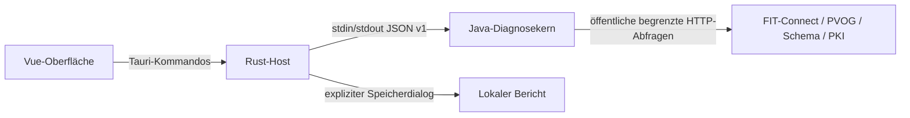

# Architektur und öffentliche Verträge

FBForge Inspect 0.1.0 ist eine lokale Desktop-Anwendung mit drei Schichten.



Die Vue-Oberfläche besitzt keinen direkten Netzwerkzugriff auf externe APIs. Der Rust-Host stellt ausschließlich `diagnose`, `cancel` und `save_report` bereit. Er startet pro Prüflauf einen gebündelten Java-Prozess, begrenzt Ein- und Ausgabe und beendet ihn bei Abbruch oder Zeitüberschreitung. Es gibt keinen lokalen HTTP-Server und kein Shell-Plugin. Der Entwicklungsmodus kann den lokal installierten Java-Befehl verwenden, eine Release-App benötigt ihre gebündelte Laufzeit.

Der Java-Kern implementiert die öffentlichen API-Verträge eigenständig. Er enthält keinen FIT-Connect-SDK-Adapter. `Api` übernimmt Destination, Routing, Prozesssuche und PVOG-Seiten, `KeyDiagnostics` die JWK-Regeln, `Certificates` PKIX und Sperrstatus, `Signatures` Adressierungssignaturen, `Schemas` sichere Strukturinspektion und `PublicHttp` die gemeinsame Transportgrenze.

## IPC v1

Eine Anfrage pro Prozess, JSON in UTF-8 über stdin bis EOF:

```json
{"protocolVersion":1,"operation":"destination","environment":"TEST","apiVersion":"v3","input":{"destinationId":"00000000-0000-4000-8000-000000000001"}}
```

Operationen: `destination`, `routing`, `areas`, `process`, `keys`, `schema`. Die Antwort enthält `ok` und bei Erfolg `report`, sonst eine bereinigte Fehlermeldung ohne Eingabewerte oder Stacktrace. Der Diagnosebericht enthält Version, Operation, Umgebung, Zeit, Befunde, normalisierte Daten, Abfrageprotokoll und separat gehaltene Rohantworten. Die Exportansicht entfernt Rohantworten standardmäßig.

Ein Befund hat Status, Titel, Erklärung, Feldpfad, Quelle, nächsten Schritt und Beweisgrenze. HTTP-Erfolg wird nur im Abfrageprotokoll geführt und nicht mit fachlicher Gültigkeit gleichgesetzt. Die Zustände lauten `confirmed`, `error`, `warning`, `unknown`, `notApplicable`.

## Grenzen

2 MiB Eingabe, 4 MiB je Antwort, 20 MiB Gesamtantwortbudget, 40 HTTP-Abrufe, 120 Sekunden Netzbudget, maximal 20 Routingseiten und 10 PVOG-Seiten. Höchstens 20 Adressierungssignaturen werden verifiziert, weitere Kontexte bleiben ausdrücklich ungeprüft. Der Host beendet einen Lauf spätestens nach 150 Sekunden. Schlüsselsätze sind auf 32 Schlüssel und x5c-Ketten auf zehn Zertifikate begrenzt. Schemaansichten haben Tiefen- und Knotengrenzen.

`PublicHttp` prüft DNS-Ergebnisse auf öffentliche IP-Adressen und verbindet den Socket mit genau einer geprüften Adresse. TLS-SNI und Hostnamenprüfung verwenden weiterhin den ursprünglichen Hostnamen. Jede Umleitung wird erneut geprüft. Private Netze, Zugangsdaten-URLs, Sonderports, TLS-Downgrades und übergroße Antworten werden blockiert. Komprimierte HTTP-Antworten werden nicht akzeptiert.

## Entscheidungen

Tauri und Vue halten die Anwendung in der bestehenden FBForge-Produktfamilie. Java übernimmt die PKI-Prüfungen mit etablierten Bibliotheken. Der eigene reduzierte Kern vermeidet eine Abhängigkeit von authentifizierten SDK-Funktionen. Ein Prozess pro Lauf macht Abbruch und Sitzungsende überprüfbar.

Keine empfangene CA-Wurzel wird automatisch zum Vertrauensanker. Ein ausdrücklich geladener Anker beweist PKIX-Vertrauen gegen diese CA, deren V-PKI-Zugehörigkeit ist separat zu prüfen. OCSP/CRL werden unabhängig davon bewertet. Referenzen von JSON Schema und XSD werden nie automatisch aufgelöst. Eine Strukturansicht wird nicht als vollständige Validierung ausgegeben.

`docs/help.json` ist die gemeinsame Hilfequelle. Vue bündelt sie offline, `scripts/build-help.mjs` exportiert daraus die statische Websitehilfe. Lokale Arbeitsplanung und Abnahmebelege liegen in `.local/` und werden nicht versioniert.
